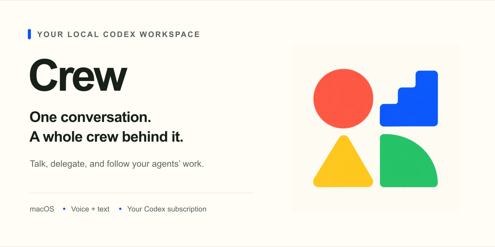

<p align="center">
  
</p>

# Crew

**A local macOS workspace for coordinating Codex agents through voice and text.**

Talk to your manager, delegate work to independent workers, and follow what they are doing without juggling separate chats. Crew brings your projects, conversations and worker activity into one desktop app, using your existing ChatGPT/Codex subscription.

[**Download for Mac**](https://github.com/MattGibney/Crew/releases/latest) · [Getting started](#get-started) · [Documentation](#documentation) · [Report a bug](https://github.com/MattGibney/Crew/issues/new) · [Contributing](CONTRIBUTING.md)

## One conversation. A whole crew behind it.

| | What you can do |
| --- | --- |
| **Talk or type** | Keep one manager conversation across text and live voice. Connect explicitly when you want to start a call. |
| **Delegate in parallel** | Work with independent Codex workers, each with its own conversation and Git worktree. Inspect their activity, shared notes and related links. |
| **Switch projects** | Give each project its own configuration, manager conversation and workers, with a shared worker-capacity setting across the app. |
| **Make it yours** | Edit manager and worker instructions, customize the manager profile and voice, and inspect the manager's saved scratchpad. |
| **Keep work in view** | See worker cards and attention in the app and menu bar. Closing the window ends voice while background work can continue. |

Crew runs on your Mac. Codex and connected services still need their own network access and authentication. There is no Crew-hosted account, project service or cloud sync.

## Get started

### What you need

- **Apple Silicon Mac with macOS 13 or later.** Current desktop releases do not include Intel, Windows or Linux builds.
- **Git** and a compatible **Codex CLI**, signed in with your ChatGPT/Codex subscription.
- A local project repository. Connect the project's intended MCP tools in Codex; Linear-backed workflows need the appropriate Linear connection.

Crew includes the desktop Node runtime. A separate Node installation is only needed to develop or run Crew from source. Realtime support uses experimental Codex methods, so check [macOS requirements](docs/MACOS.md#requirements) if your CLI version is incompatible. There is no API-key fallback.

### Install and have your first conversation

1. Open the [latest release](https://github.com/MattGibney/Crew/releases/latest) and download the Apple Silicon **`.dmg`**. Public release builds are Developer ID signed and notarized.
2. Open the disk image, drag **Crew** to **Applications**, and launch it.
3. Follow the guided setup to check Codex sign-in and select your project folder. Review the discovered project settings and connected-tool choices.
4. Type to your manager, or choose **Connect voice**. Connecting starts the microphone once permission allows; mute or end the call when you want to stop. Switching apps does not mute an open call.
5. Agree a small first task and check its result before moving on to important work.

Use the project switcher to add another workspace. Settings lets you adjust instructions, profile, environment commands and capacity later. See [Mac installation and operations](docs/MACOS.md), [Settings](docs/SETTINGS.md) and [project discovery](docs/ONBOARDING.md) for details.

## Your work stays outside the app

The default configuration lives under `~/Library/Application Support/Crew/instances/default/`. Other workspaces retain separate configuration and state. Editable prompts, saved conversations and worker records are stored outside the application bundle.

Updates can be checked and downloaded from the app; installation requires an explicit restart when Crew can safely do so. Quitting and closing a window are separate actions. See [updates and recovery](docs/UPDATES.md) and [storage](docs/STORAGE.md) before moving installations or managing a custom configuration root.

**Crew is early software under active development.** Review agent output and test changes before relying on them. A worker finishing is not proof that its code is correct or production-ready. Platform, native-update and device-audio acceptance limits are recorded in the [release documentation](docs/RELEASES.md); consult the notes for the version you install.

## Documentation

| I want to… | Read |
| --- | --- |
| Install, configure or troubleshoot Crew | [Mac operations](docs/MACOS.md) · [Configuration](docs/CONFIGURATION.md) · [Onboarding](docs/ONBOARDING.md) |
| Manage projects, instructions and profiles | [Workspaces](docs/multi-project-workspaces.md) · [Settings](docs/SETTINGS.md) |
| Understand workers and their environments | [Workers](docs/WORKERS.md) · [Project environments](docs/PROJECT-ENVIRONMENTS.md) |
| Understand the manager and voice interface | [Manager workspace](docs/MANAGER-WORKSPACE.md) · [Scratchpad](docs/MANAGER-SCRATCHPAD.md) |
| Build, extend or maintain Crew | [Architecture](docs/ARCHITECTURE.md) · [UI and themes](docs/UI-FOUNDATION.md) · [Contributing](CONTRIBUTING.md) |
| Publish a release or maintain branding | [Release process](docs/RELEASES.md) · [Brand assets](docs/brand/README.md) |

## Develop locally

Use **Node.js 22+** and Git. On an Apple Silicon Mac:

```sh
git clone https://github.com/MattGibney/Crew.git
cd Crew
npm ci
npm test
npm run desktop:dev
```

`npm test` builds the renderer and runs the automated suite. `npm run desktop:dev` opens the Electron app. Development sessions still need a compatible Codex CLI and subscription sign-in. Keep development configuration separate from the project state you use for real work.

```sh
npm run desktop:build:mac
```

Local packaging produces **unsigned candidate builds** under `dist/desktop/candidate/`. They are separate from signed public releases and do not provide a stable automatic-update feed. See the [release guide](docs/RELEASES.md) for artifact formats and signing requirements, or [Mac operations](docs/MACOS.md#local-diagnostics-and-cli-alternative) for the source-only CLI workflow.

## Help improve Crew

Found a problem? [Open an issue](https://github.com/MattGibney/Crew/issues/new) with what you expected, what happened, your Crew/macOS/Codex versions and a minimal reproduction. Remove credentials, private conversations and project data from anything you share.

Have an idea? Start with the user problem and the workflow it would improve. Check [existing issues](https://github.com/MattGibney/Crew/issues) first. Changes are developed in separate branches and reviewed through pull requests; releases are deliberately grouped. See [contribution guidance](CONTRIBUTING.md).
