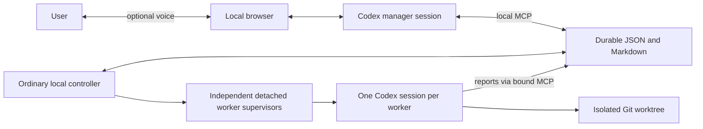

# Local architecture

One generic application instance owns one configured project. A different project requires separate configuration, port and state. No cloud control plane, database or project switcher is introduced. A bounded local scheduler supports concurrent explicitly assigned workers.

The browser/server negotiate WebRTC through Codex's supported experimental app-server. Existing ChatGPT login is required and checked. API-key/base-URL environment fallbacks are removed. The native Codex loop owns reasoning, tools and realtime handoffs; the bridge does not invoke work from transcript callbacks or duplicate native results.

Manager developer instructions combine immutable scope rules with the editable local manager prompt and this instance's project context. Worker execution combines a bound task/run with the editable worker prompt, configured project context and invariant scope rules. Neither prompt is an authorization to select new tasks. The manager mediates every user decision. The worker has only its bound reporting MCP and local code context; it does not independently use Linear.

The controller reconciles local files every 250 ms. Idle polling starts no model turn. Dispatch requires a manager submit call for an explicitly agreed ticket/brief; repository IDs must exist in configuration and ticket syntax must match the configured team key. Actual ticket membership and acceptance criteria require the manager's connector read; syntax validation is not proof that a ticket exists.

Tasks progress queued → launching → running → awaiting answer → resume queued → running → verifying → completed, or retain explicit blocked/failed attention. Atomic files, locks, task/run IDs, immutable task scope and launch claims protect replay and duplicate handling. Another project cannot reuse a bound state directory. A config change cannot promote a paused read-only worker to write access. Resume verifies the retained worktree baseline and repository identity; changing a preferred starting branch does not rewrite existing work.

The supervisor is detached from the controller and browser. It records actual public Codex command/turn evidence and a durable exit record. A worker result is only a candidate until host verification. Repository verification checks the actual worktree/root/baseline, read-only cleanliness where required, successful command evidence, completed harness turn and durable result. It labels semantic correctness and production validation false. Fixture mode additionally executes the deterministic totals checks independently.

State lives under runtime.dataDir: manager-chat.json, server.json, orchestration/tasks/*.json and .md, orchestration/runs/, worktrees and the instance/project binding. Shared Codex account credentials are never stored here; the private server marker contains only the normal local instance shutdown token. Existing prototype fixture files are preserved automatically only when no instance config exists. Back up state and worktrees before cleanup; this version does not silently delete work.

A saved manager chat may be locked by another Codex runtime. For the precise writer-conflict error, supported native fork can preserve completed history while keeping the original and local worker state; it starts no turn. Active work or other errors do not trigger recovery forks. Inspect the live app through local status endpoints rather than resuming its backing manager chat in another runtime.

## Electron desktop shell (AI-007)

The Electron main process owns one backend child running the bundled executable in Node mode. The backend retains the existing controller/manager implementation. The Chromium window is a disposable control surface: close explicitly disconnects voice and destroys the renderer, releasing its media tracks and event stream. The main process, tray and backend remain alive. Tray polling reads local task state without invoking a model. Pending unacknowledged attention produces a raised-hand indicator; opening the window recovers the same instance state.

Explicit Quit asks the user, states active or unavailable task status, authenticates shutdown against the owned controller marker and stops only that controller. Detached worker supervisors remain independent and can write durable reports. Reopening the same configured instance recovers their state. This is not a login service; after a reboot the app must be opened again.

Instance identity derives from the absolute config path. Each instance has its own Electron userData directory/Chromium partition in addition to its configured durable state and local port. The renderer has no Node integration or preload bridge; sandbox and context isolation are enabled. Media permission is restricted to audio from that instance's exact loopback origin. Navigation, downloads and new renderer windows are restricted. Opening the app never requests a microphone.

Electron includes Chromium and Node; Codex, Git, ChatGPT login and the intended MCP connections remain external prerequisites. Node-mode child execution is carried through to the task-bound MCP helper. Distribution resources are allowlisted and contain code/templates/docs, never instance config, credentials, task state or worktrees. Public arm64 releases for macOS 13+ are Developer ID signed and notarized, with a verified GitHub native update channel. Local candidates remain unsigned and cannot publish a stable feed.

## Guided setup and discovery (AI-008)

A separate sandboxed local-file window can load before Codex/config/controller prerequisites are ready. Only that exact main frame receives a bounded context-isolated preload API; the manager renderer has a separate narrow workspace-selection preload and no Node access. Fixed IPC operations cover local status checks, validated config save, native pickers/permissions and explicit startup. No generic shell/filesystem/RPC operation is exposed. Config/prompt fingerprints bind asynchronous readiness results and proposal apply; stale results are discarded.

Optional project analysis uses one cancelable subscription Codex setup job over a sanitized bounded snapshot, with tools/scripts disabled, outside manager/business task state. It produces source-grounded project context. Validated automatic apply writes new versioned prompts and atomically updates configuration with a backup. Actual Git branch discovery and separate ephemeral direct MCP Linear reads supply paths/refs/team/project IDs; generated prose cannot invent them. Ordinary users see recognizable choices rather than raw JSON/Markdown review. Existing state identity and active task/manager/voice guards remain in force. No setup action launches business work. See ONBOARDING.md for permission limits and readiness distinctions.

## Concurrent execution and environments (AI-011)

Executing capacity is configurable (default two), with a durable queue and independent per-task provisioning/cleanup. Question-yielded runs release capacity; target/run-correlated lifecycle requests support stop/pause/resume/start/dispose and idempotent retries. Supervisors own their Codex process groups, record actual exits and support durable stop controls. Restart reconciles surviving runs without duplicate launch; execution timing excludes waiting. Disposable fixtures cover concurrent workers and optional shell-free bounded environment hooks. See [worker lifecycle](WORKERS.md) for contracts and project-tool limitations.

## React renderer foundation (AI-013)

Both manager and native setup are compiled React JavaScript entry points. Vite produces local static assets; no dev server or runtime npm dependencies are shipped. Official shadcn/ui Base UI components and Lucide share one semantic Tailwind 4 stylesheet. See [theme and component workflow](UI-FOUNDATION.md). The loopback server discovers an exact bounded asset allowlist, rejects linked/replaced files, and exposes only manager HTML plus built assets. Native setup is loaded from its exact compiled local-file URL and alone receives the bounded setup preload; manager pages receive the separate workspace bridge. Native UI and actual audible acceptance of this migration await user unlock; browser, simulated lifecycle, actual subscription preparation and bundled-runtime checks passed.

## Multiple workspaces (GitHub issue #2)

The native parent owns one workspace registry, selected window, tray, updater and global capacity setting. Each project-host closure owns one independent controller/config/state/port/chat and its retained Chromium partition. Registry adoption leaves existing config, prompts, conversations and worker/worktree evidence in place. All-project update activity and reservations query every managed controller; unknown liveness blocks installation. See [workspace storage, capacity and update contracts](multi-project-workspaces.md). The separately developed coordinated pause engine and Settings lifecycle require combined acceptance after integration.
