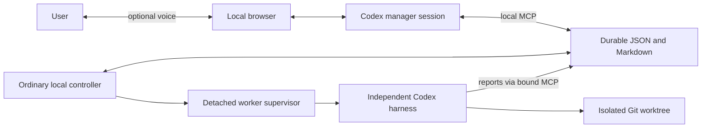

# Local architecture

One generic application instance owns one configured project. A different project requires separate configuration, port and state. No cloud control plane, database, project switcher or multiworker scheduler is introduced.

The browser/server negotiate WebRTC through Codex's supported experimental app-server. Existing ChatGPT login is required and checked. API-key/base-URL environment fallbacks are removed. The native Codex loop owns reasoning, tools and realtime handoffs; the bridge does not invoke work from transcript callbacks or duplicate native results.

Manager developer instructions combine immutable scope rules with the editable local manager prompt and this instance's project context. Worker execution combines a bound task/run with the editable worker prompt, configured project context and invariant scope rules. Neither prompt is an authorization to select new tasks. The manager mediates every user decision. The worker has only its bound reporting MCP and local code context; it does not independently use Linear.

The controller polls local files once per second. Idle polling starts no model turn. Dispatch requires a manager submit call for an explicitly agreed ticket/brief; repository IDs must exist in configuration and ticket syntax must match the configured team key. Actual ticket membership and acceptance criteria require the manager's connector read; syntax validation is not proof that a ticket exists.

Tasks progress queued → launching → running → awaiting answer → resume queued → running → verifying → completed, or retain explicit blocked/failed attention. Atomic files, locks, task/run IDs, immutable task scope and launch claims protect replay and duplicate handling. Another project cannot reuse a bound state directory. A config change cannot promote a paused read-only worker to write access. A moved base ref fails resume for review.

The supervisor is detached from the controller and browser. It records actual public Codex command/turn evidence and a durable exit record. A worker result is only a candidate until host verification. Repository verification checks the actual worktree/root/baseline, read-only cleanliness where required, successful command evidence, completed harness turn and durable result. It labels semantic correctness and production validation false. Fixture mode additionally executes the deterministic totals checks independently.

State lives under runtime.dataDir: manager-chat.json, server.json, orchestration/tasks/*.json and .md, orchestration/runs/, worktrees and the instance/project binding. Runtime credentials are never stored here. Existing prototype fixture files are preserved automatically only when no instance config exists. Back up state and worktrees before cleanup; this version does not silently delete work.

A saved manager chat may be locked by another Codex runtime. For the precise writer-conflict error, supported native fork can preserve completed history while keeping the original and local worker state; it starts no turn. Active work or other errors do not trigger recovery forks. Inspect the live app through local status endpoints rather than resuming its backing manager chat in another runtime.

## Electron desktop shell (AI-007)

The Electron main process owns one backend child running the bundled executable in Node mode. The backend retains the existing controller/manager implementation. The Chromium window is a disposable control surface: close explicitly disconnects voice and destroys the renderer, releasing its media tracks and event stream. The main process, tray and backend remain alive. Tray polling reads local task state without invoking a model. Pending unacknowledged attention produces a raised-hand indicator; opening the window recovers the same instance state.

Explicit Quit asks the user, states active or unavailable task status, authenticates shutdown against the owned controller marker and stops only that controller. Detached worker supervisors remain independent and can write durable reports. Reopening the same configured instance recovers their state. This is not a login service; after a reboot the app must be opened again.

Instance identity derives from the absolute config path. Each instance has its own Electron userData directory/Chromium partition in addition to its configured durable state and local port. The renderer has no Node integration or preload bridge; sandbox and context isolation are enabled. Media permission is restricted to audio from that instance's exact loopback origin. Navigation, downloads and new renderer windows are restricted. Opening the app never requests a microphone.

Electron includes Chromium and Node; Codex, Git, ChatGPT login and the intended MCP connections remain external prerequisites. Node-mode child execution is carried through to the task-bound MCP helper. Distribution resources are allowlisted and contain code/templates/docs, never instance config, credentials, task state or worktrees. The current release is unsigned arm64 for macOS 13+; signing, notarization and a trusted update channel are separate release work.

## Guided setup and discovery (AI-008)

A separate sandboxed local-file window can load before Codex/config/controller prerequisites are ready. Only that exact main frame receives a bounded context-isolated preload API; the ordinary manager renderer retains no preload or Node access. Fixed IPC operations cover local status checks, validated config save, native pickers/permissions and explicit startup. No generic shell/filesystem/RPC operation is exposed. Config/prompt fingerprints bind asynchronous readiness results and proposal apply; stale results are discarded.

Optional project analysis uses one cancelable subscription Codex setup job over a sanitized bounded snapshot, with tools/scripts disabled, outside manager/business task state. It returns inferred/unknown evidence and review-required JSON/Markdown. Explicit reviewed apply writes new versioned prompts and atomically updates validated configuration with a backup. Existing state identity and active task/manager/voice guards remain in force. No setup action launches business work. See ONBOARDING.md for permission limits and readiness distinctions.
